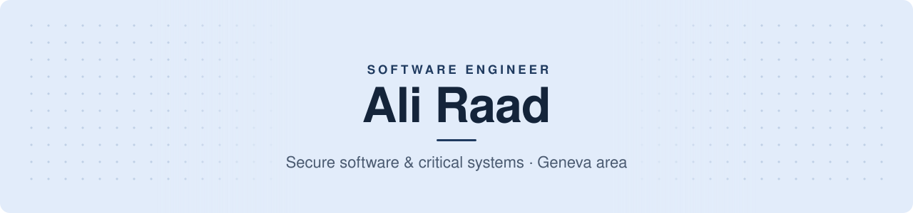

<picture>
  <source media="(prefers-color-scheme: dark)" srcset="assets/banner-dark.svg">
  
</picture>

  
  
  

 

I build secure, maintainable backends: authentication, cloud infrastructure and threat detection.

At **Société Générale**, on the Digital Banking Security team, I led the migration of the digital-banking authentication system from Spring MVC on WildFly to **Spring Boot**, through to production for **3.5 million customers**. I also remediated OWASP / CVE vulnerabilities and handled production incidents end to end.

 

<table>
  <tr>
    <td width="33%" valign="top">
      <b>Application security</b> 
      OAuth2 / JWT · Spring Security · RBAC · OWASP &amp; CVE remediation · SIEM design · forensics
    </td>
    <td width="33%" valign="top">
      <b>Architecture</b> 
      C4 · DDD · TDD · layered and clean design · code review
    </td>
    <td width="33%" valign="top">
      <b>Cloud &amp; delivery</b> 
      GCP · Terraform · Kubernetes / GKE · Helm · Docker · Jenkins · GitHub Actions · GitLab CI
    </td>
  </tr>
</table>

 

## Projects

<table>
  <tr>
    <td width="50%" valign="top">
      <h3><a href="https://github.com/alir961/soodora-platform">Soodora</a></h3>
      EPITECH INNOVATIVE PROJECT · 2024–2026
      
A platform for independent artists, built over two years. Spring Boot 3 API with a layered <b>DDD</b> architecture and <b>563 tests</b>, Vue / Ionic app, Stripe marketplace.

      <code>Java 21</code> <code>Spring Boot</code> <code>Spring Security</code> <code>Vue 3</code> <code>Stripe</code>
    </td>
    <td width="50%" valign="top">
      <h3><a href="https://github.com/alir961/network-siem-c2-detection">Network SIEM</a></h3>
      EPITECH · INCIDENT-RESPONSE EXERCISE
      
Reverse-engineered the implant on a simulated compromised hospital bastion (C2, multi-layer persistence, IDS bypass) and turned it into <b>9 detection rules</b> for beaconing, exfiltration, DGA, scans and tunnels, with safe automatic iptables containment.

      <code>Python</code> <code>Scapy</code> <code>iptables</code> <code>Forensics</code>
    </td>
  </tr>
  <tr>
    <td width="50%" valign="top">
      <h3><a href="https://github.com/alir961/gcp-gke-terraform-platform">GCP Platform as Code</a></h3>
      INFRASTRUCTURE AS CODE
      
A whole Google Cloud platform in <b>Terraform</b>: IAM, GKE with pod and node autoscaling, private Cloud SQL with Secret Manager, HTTPS ingress, Prometheus / Grafana, keyless GitHub Actions.

      <code>Terraform</code> <code>GKE</code> <code>Helm</code> <code>Cloud SQL</code> <code>FastAPI</code>
    </td>
    <td width="50%" valign="top">
      <h3><a href="https://github.com/alir961/trekul-hiking-booking-platform">TrekUL</a></h3>
      UNIVERSITÉ LAVAL · SOFTWARE ARCHITECTURE
      
Java REST API with a layered <b>DDD</b> architecture, built test-first: <b>150+ test classes</b>, coverage and quality gates, 300K+ open-data records ingested and validated.

      <code>Java</code> <code>JAX-RS</code> <code>JUnit 5</code> <code>Mockito</code>
    </td>
  </tr>
</table>

<b>Also</b> &nbsp; <a href="https://github.com/alir961/r-type-game-engine">R-Type engine</a>, C++20 multiplayer engine (UDP, ECS, runtime modules) &nbsp;·&nbsp; <a href="https://github.com/alir961/zenfit-ai-movement-analysis">ZenFit</a>, real-time 3D pose estimation &nbsp;·&nbsp; <a href="https://github.com/alir961/panoramix-threads-semaphores">Panoramix</a>, thread synchronisation in C &nbsp;·&nbsp; <a href="https://github.com/alir961/sneakers-avenue-ecommerce">Sneakers Avenue</a>, security-reviewed e-commerce

 

## Stack

  
  
  
  
  
  
  
  
  
  
  
    
  
  
  
  
  
  
  
  
  
  
  

 

## Background

<table>
  <tr>
    <td width="50%" valign="top">
      <b>Education</b> 
      M2 Software Engineering Expert · Epitech Paris · 2026 
      M1 exchange · Université Laval, Québec · 2025 
      Bachelor in Information Technology · Epitech Lyon · 2024
    </td>
    <td width="50%" valign="top">
      <b>Certifications</b> 
      Google Cloud Cybersecurity Certificate · 2026 
      Google Cloud Computing Foundations · 2026 
      4 Google Cloud skill badges · network security, load balancing, app dev, ML APIs · 2025–2026
    </td>
  </tr>
</table>
